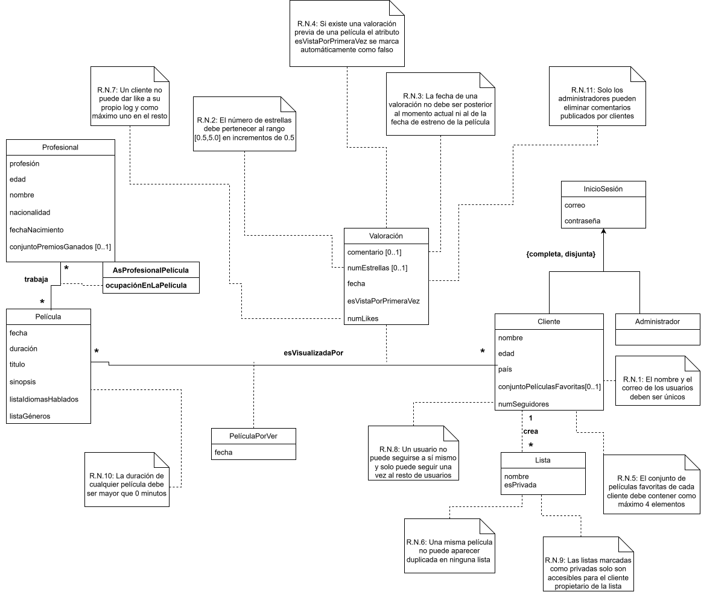
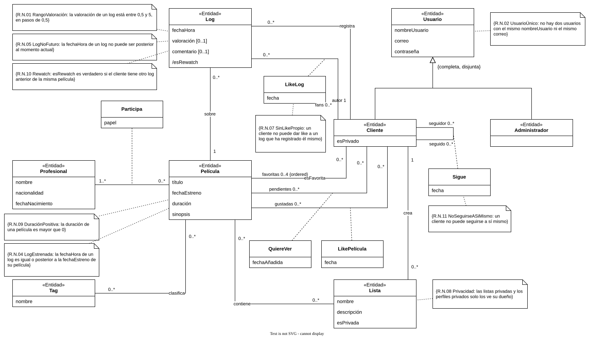
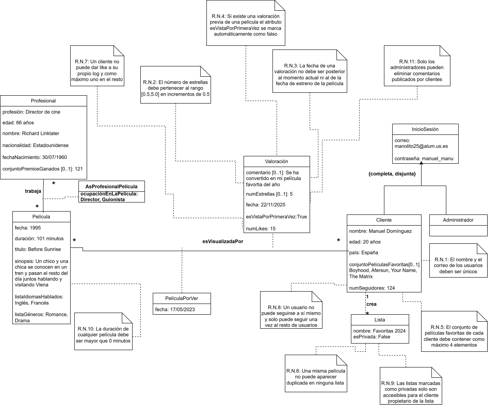
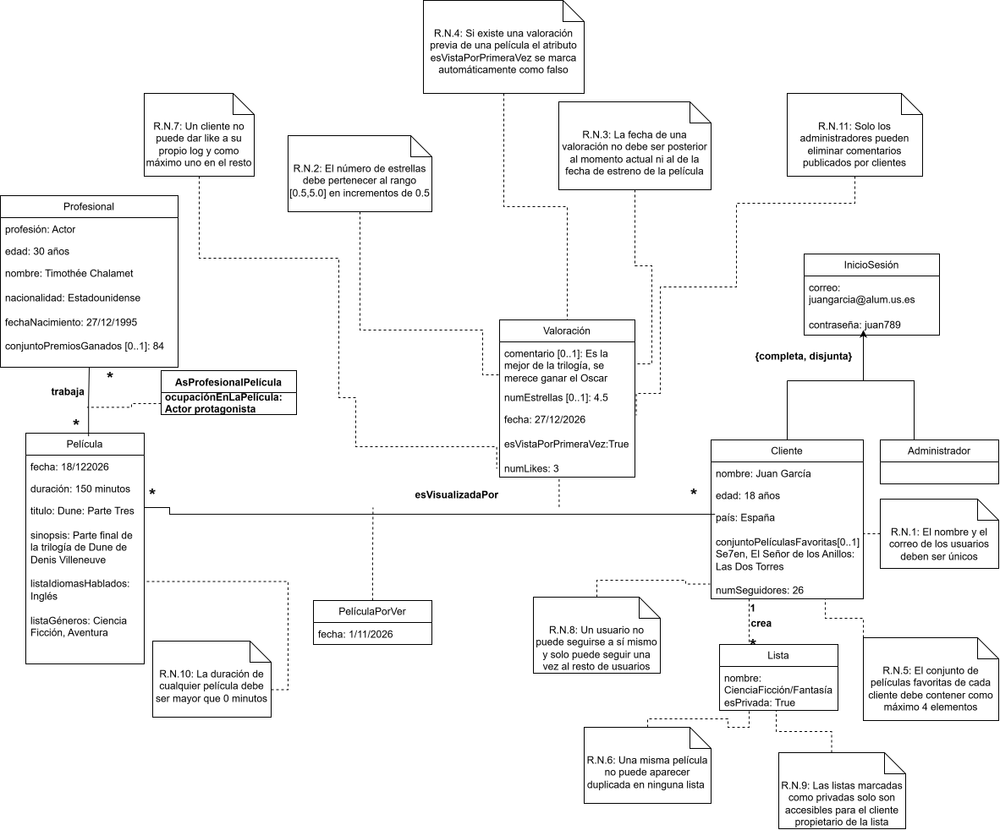
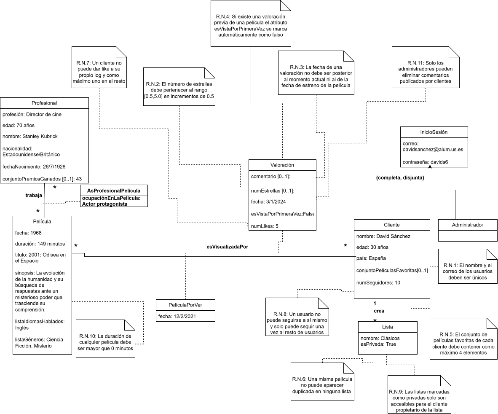

# FilmUS

## Miembros del grupo L1-DF/AM-6

1. Sánchez Limón, Jose
2. Enrique Rosado, Jaime
3. Rafael Trampler Alejo, Mateo
4. Almeida Reyes, Joel

## 1. Introducción al problema

Hoy en día consumimos muchísimo cine gracias a la gran variedad de plataformas de streaming existentes, pero no tenemos una forma sencilla y centralizada de organizar lo que vemos. La mayoría de los aficionados al cine terminan apuntando películas en notas del móvil, listas sueltas o confiando en la memoria, lo que hace que se olviden valoraciones, recomendaciones o títulos que querían ver. Además, las redes sociales convencionales no están pensadas para cine: los comentarios se pierden entre otro contenido, los spoilers están a la orden del día y resulta difícil explorar el trabajo de los actores y directores tras cada película.

Para resolver esto creamos FilmUS, una plataforma web pensada por y para amantes del cine. El sistema cuenta con dos tipos de usuarios: los clientes, que pueden registrar sus visualizaciones, valorar películas, escribir reseñas, organizar listas y seguir a otros usuarios respetando la privacidad de su perfil; y los administradores, encargados de gestionar el catálogo y moderar comportamientos o comentarios inapropiados para mantener un entorno sano. Con este proyecto esperamos ofrecer una herramienta intuitiva que centralice toda esta experiencia y ayude a la comunidad cinéfila a descubrir y compartir contenido de forma cómoda y organizada.

## 2. Glosario de términos

- **Favoritas**: Películas (como máximo 4) que un cliente elige para destacar en su perfil.
- **Like**: Valoración positiva que hace un cliente sobre el log de otro cliente o sobre una película.
- **Log**: Es el registro del cliente que indica que ha visto una película en concreto, con una valoración y comentario opcionales.
- **Perfil**: Página de un cliente donde se muestran sus logs, listas y películas favoritas. Puede ser público o privado.
- **Profesional**: Persona que participa en una película (por ejemplo: director, actor, guionista).
- **Rewatch**: Cuando se registra que el cliente ha visto una misma película más de una vez.
- **Seguir**: Acción de un cliente para estar al tanto de la actividad de otro cliente con perfil público.
- **Tags**: Etiqueta que se puede atribuir a una película y que la engloba con otras, por ejemplo: terror, drama, ciencia ficción.
- **Watchlist**: Lista especial de películas que el cliente tiene pendiente por ver. Cada cliente tiene una.

## 3. Visión general del sistema

### 3.1. Requisitos generales

R.G.01. Gestión de usuarios

    Como cliente o administrador

    quiero tener una cuenta con perfil propio

    para poder identificarme en la aplicación, ver los perfiles de otros cinéfilos y elegir si quiero que mi perfil sea público o privado.

R.G.02. Gestión de películas

    Como cliente o administrador

    quiero ver un catálogo con las películas disponibles y sus datos principales

    para buscar películas que me interesen, leer de qué van y descubrir títulos nuevos.

R.G.03. Gestión de valoraciones (Logs y reseñas)

    Como cliente o administrador

    quiero marcar las películas que he visto, ponerles nota y escribir opiniones

    para llevar el control de todo lo que voy viendo y compartir mis críticas con la comunidad.

R.G.04. Gestión de listas personalizadas

    Como cliente

    quiero organizar películas en listas temáticas creadas por mí

    para guardar selecciones personalizadas, enseñárselas a otros usuarios y ver las listas que hace la gente.

R.G.05. Gestión de películas por ver (Watchlist)

    Como cliente

    quiero tener una lista especial de películas pendientes de ver

    para ir apuntando las películas que me llaman la atención y no olvidarme de verlas en el futuro.

R.G.06. Gestión de profesionales y su asignación a películas

    Como cliente o administrador

    quiero ver la información de actores y directores y en qué películas han trabajado

    para conocer al equipo que hay detrás de cada película y buscar más obras de mis artistas favoritos.

---

### 3.2. Usuarios del sistema

- **Cliente**: Puede registrar películas vistas, valorar películas, escribir comentarios, dar likes, crear listas, seguir a otros clientes y consultar perfiles públicos.
- **Administrador**: Se encarga de controlar la actividad de los clientes y eliminar contenido inapropiado o erróneo.

## 4. Catálogo de requisitos

### 4.1. Requisitos funcionales

#### 4.1.1. Módulo R.G.01: Gestión de usuarios

R.F.1.01. Registrar usuario (Create)

    Como cliente

    quiero crear una cuenta en la aplicación indicando mis datos de registro

    para poder acceder a la plataforma y tener mi propio perfil personal.

**- Pruebas de aceptación**

1- Comprobar que un cliente se puede registrar proporcionando nombre de usuario, correo electrónico y contraseña.

2- Verificar que el sistema rechaza el registro si el nombre de usuario o el correo electrónico ya existen en la base de datos.

R.F.1.02. Consultar perfil de usuario (Read)

    Como cliente o administrador

    quiero consultar los datos de perfil de un usuario

    para conocer su información general, sus películas vistas y sus listas públicas.

**- Pruebas de aceptación**

1- Comprobar que cualquier usuario puede consultar un perfil público y ver su información básica.

2- Verificar que si un perfil es privado, solo el propio dueño puede ver sus detalles completos.

R.F.1.03. Actualizar datos de usuario (Update)

    Como cliente

    quiero modificar mis datos personales y la privacidad de mi cuenta

    para mantener mi información actualizada o cambiar el nivel de visibilidad de mi perfil.

**- Pruebas de aceptación**

1- Comprobar que un cliente puede actualizar su contraseña o cambiar su privacidad entre pública y privada.

2- Verificar que si el cliente intenta modificar su nombre de usuario por uno ya existente, el sistema bloquea los cambios y muestra un error.

R.F.1.04. Dar de baja usuario (Delete)

    Como cliente o administrador

    quiero eliminar una cuenta de usuario del sistema

    para cancelar el acceso a la plataforma o retirar cuentas inapropiadas.

**- Pruebas de aceptación**

1- Comprobar que un cliente puede solicitar y confirmar la eliminación de su propia cuenta.

2- Comprobar que un administrador puede dar de baja la cuenta de cualquier cliente en caso de infracción.

3- Verificar que tras eliminar la cuenta, no se puede volver a iniciar sesión con las mismas credenciales.

---

#### 4.1.2. Módulo R.G.02: Gestión de películas

R.F.2.01. Crear película (Create)

    Como administrador

    quiero añadir una nueva película al catálogo general

    para que los usuarios tengan disponible el título en la plataforma.

**- Pruebas de aceptación**

1- Comprobar que un administrador puede dar de alta una película ingresando título, fecha de estreno, duración y sinopsis.

2- Verificar que el sistema no permite dar de alta una película con una duración igual o inferior a 0 minutos.

R.F.2.02. Consultar película (Read)

    Como cliente o administrador

    quiero consultar la ficha técnica y detalles de una película

    para conocer su sinopsis, duración, fecha de estreno y notas generales.

**- Pruebas de aceptación**

1- Comprobar que un cliente puede buscar y abrir la ficha de cualquier película registrada.

2- Verificar que el sistema muestra correctamente la información básica del título seleccionado.

R.F.2.03. Actualizar película (Update)

    Como administrador

    quiero modificar la información de una película existente

    para corregir erratas o actualizar sinopsis y fechas de estreno.

**- Pruebas de aceptación**

1- Comprobar que un administrador puede editar cualquier campo de la ficha técnica de una película.

2- Verificar que el sistema guarda los cambios y los refleja inmediatamente en las búsquedas.

R.F.2.04. Eliminar película (Delete)

    Como administrador

    quiero borrar una película del catálogo

    para retirar entradas duplicadas o erróneas.

**- Pruebas de aceptación**

1- Comprobar que un administrador puede eliminar una película del sistema.

2- Verificar que la película eliminada deja de aparecer en las búsquedas del catálogo general.

---

#### 4.1.3. Módulo R.G.03: Gestión de valoraciones (Logs y reseñas)

R.F.3.01. Crear valoración (Create)

    Como cliente

    quiero registrar una película como vista asignando puntuación y un comentario opcional

    para guardar mi experiencia con esa película en mi historial personal.

**- Pruebas de aceptación**

1- Comprobar que un cliente puede guardar un log eligiendo fecha, valoración en estrellas y un texto de comentario.

2- Verificar que la valoración en estrellas se mantiene en la escala de 0,5 a 5 con incrementos de 0,5.

3- Verificar que se marca automáticamente como rewatch si la película ya había sido registrada anteriormente por el mismo cliente.

R.F.3.02. Consultar valoraciones (Read)

    Como cliente o administrador

    quiero leer las valoraciones y reseñas asociadas a una película o usuario

    para conocer la opinión de otros clientes de la comunidad.

**- Pruebas de aceptación**

1- Comprobar que se muestra el listado de logs y reseñas publicadas en la ficha de cada película.

2- Verificar que la fecha y hora mostradas corresponden al momento exacto en el que se guardó la publicación.

R.F.3.03. Actualizar valoración (Update)

    Como cliente

    quiero modificar el texto o la puntuación de un log guardado previamente

    para corregir erratas o cambiar mi valoración tras volver a ver la película.

**- Pruebas de aceptación**

1- Comprobar que el autor de una valoración puede cambiar las estrellas asignadas o editar el cuerpo de su reseña.

2- Verificar que las modificaciones cumplen las restricciones de rango de puntuación exigidas por el sistema.

R.F.3.04. Eliminar valoración o comentario (Delete)

    Como cliente o administrador

    quiero eliminar un log completo o moderar un comentario inapropiado

    para borrar registros no deseados o mantener la convivencia pacífica en la plataforma.

**- Pruebas de aceptación**

1- Comprobar que un cliente puede eliminar sus propios logs completos.

2- Comprobar que un administrador puede borrar únicamente el texto de un comentario inapropiado preservando el resto del log (fecha y nota).

3- Verificar que un cliente no puede eliminar los comentarios de otros usuarios.

---

#### 4.1.4. Módulo R.G.04: Gestión de listas personalizadas

R.F.4.01. Crear lista personalizada (Create)

    Como cliente

    quiero crear una lista temática con nombre, descripción y nivel de privacidad

    para empezar a agrupar películas según mi criterio.

**- Pruebas de aceptación**

1- Comprobar que un cliente puede definir una nueva lista especificando título y visibilidad.

2- Verificar que la lista recién creada se añade correctamente a la sección de listas del perfil.

R.F.4.02. Consultar lista personalizada (Read)

    Como cliente o administrador

    quiero consultar el contenido y la selección de películas de una lista

    para descubrir agrupaciones de películas hechas por mí o por otros usuarios.

**- Pruebas de aceptación**

1- Comprobar que se pueden visualizar todas las películas asociadas a una lista pública.

2- Verificar que una lista privada solo es accesible para el usuario que la creó.

R.F.4.03. Actualizar lista personalizada (Update)

    Como cliente

    quiero añadir, quitar o reordenar películas dentro de una lista propia, o modificar su nombre

    para mantener mis listas temáticas organizadas.

**- Pruebas de aceptación**

1- Comprobar que el dueño de la lista puede añadir nuevos títulos o borrar los existentes.

2- Verificar que el sistema bloquea los intentos de añadir dos veces la misma película dentro de una misma lista.

R.F.4.04. Eliminar lista personalizada (Delete)

    Como cliente

    quiero borrar una lista que he creado previamente

    para deshacerme de agrupaciones de películas que ya no me interesan.

**- Pruebas de aceptación**

1- Comprobar que el usuario puede pulsar sobre la opción de borrar lista y confirmar su eliminación.

2- Verificar que la lista desaparece del perfil del cliente y deja de estar disponible para consulta.

---

#### 4.1.5. Módulo R.G.05: Gestión de películas por ver (Watchlist)

R.F.5.01. Añadir a la lista de pendientes (Create)

    Como cliente

    quiero incluir una película dentro de mi lista de pendientes por ver

    para recordar que tengo interés en verla más adelante.

**- Pruebas de aceptación**

1- Comprobar que se puede pulsar el botón de añadir a watchlist en cualquier ficha de película.

2- Verificar que se permite guardar películas pendientes que aún no hayan sido estrenadas.

R.F.5.02. Consultar la lista de pendientes (Read)

    Como cliente

    quiero revisar el listado completo de mis películas guardadas en la watchlist

    para seleccionar qué película ver en mi tiempo libre.

**- Pruebas de aceptación**

1- Comprobar que el cliente puede entrar a su sección de watchlist y ver todas las películas guardadas junto a la fecha en que se añadieron.

2- Verificar que la watchlist es una sección propia y privada asociada a la cuenta del usuario.

R.F.5.03. Actualizar la lista de pendientes (Update)

    Como cliente

    quiero modificar notas o el orden de prioridad de las películas registradas en mi watchlist

    para destacar las películas que quiero ver primero.

**- Pruebas de aceptación**

1- Comprobar que el cliente puede reordenar las entradas guardadas en la watchlist.

2- Verificar que el sistema impide agregar duplicados de una misma película en la watchlist.

R.F.5.04. Quitar de la lista de pendientes (Delete)

    Como cliente

    quiero eliminar un título de mi lista de pendientes

    para retirar películas que ya he visto o en las que he perdido el interés.

**- Pruebas de aceptación**

1- Comprobar que el cliente puede retirar cualquier entrada guardada en su watchlist.

2- Verificar que la película se elimina de la lista de pendientes de forma inmediata.

---

#### 4.1.6. Módulo R.G.06: Gestión de profesionales y su asignación a películas

R.F.6.01. Crear profesional y asignación (Create)

    Como administrador

    quiero dar de alta un profesional y asignarlo con un rol específico a una película

    para construir el reparto e historia técnica de las obras.

**- Pruebas de aceptación**

1- Comprobar que un administrador puede registrar un profesional con su nombre, nacionalidad y fecha de nacimiento.

2- Comprobar que se puede asociar dicho profesional a una película indicando su papel (ej. actor, director, guionista).

R.F.6.02. Consultar profesional y asignaciones (Read)

    Como cliente o administrador

    quiero consultar los datos de un profesional y ver la lista de películas en las que ha participado

    para explorar la trayectoria y filmografía de un actor o director.

**- Pruebas de aceptación**

1- Comprobar que al consultar la ficha de un profesional se listan sus películas agrupadas por su papel en cada una.

2- Verificar que al consultar la película se listan todos los profesionales asignados al reparto.

R.F.6.03. Actualizar profesional o asignación (Update)

    Como administrador

    quiero modificar la ficha de un profesional o ajustar el rol que desempeñó en una película

    para corregir datos biográficos o ajustar detalles de las asignaciones.

**- Pruebas de aceptación**

1- Comprobar que un administrador puede modificar los datos personales de un profesional o el nombre de su personaje/rol en una película.

2- Verificar que los cambios actualizados se reflejan de forma coherente en las fichas de las películas asociadas.

R.F.6.04. Eliminar profesional o asignación (Delete)

    Como administrador

    quiero desvincular un profesional de una película o darlo de baja del sistema

    para corregir errores en los créditos de una obra o eliminar duplicados.

**- Pruebas de aceptación**

1- Comprobar que se puede eliminar la asignación entre un profesional y una película específica sin borrar los datos del profesional.

2- Comprobar que un administrador puede eliminar un registro de profesional del sistema completo.

---

#### 4.1.7. Requisitos de información

R.I.01. Información de los usuarios

    Como administrador

    quiero guardar el nombre de usuario, correo electrónico, contraseña cifrada y la privacidad del perfil (público o privado) de cada cuenta

    para poder identificarlos, gestionar sus cuentas y controlar el acceso a la plataforma.

R.I.02. Información de las películas

    Como cliente

    quiero conocer el título, fecha de estreno, duración en minutos, sinopsis y los tags asociados a cada película

    para tener la información suficiente antes de decidir verla.

R.I.03. Información de las valoraciones (Logs)

    Como cliente

    quiero que el sistema guarde el cliente que hizo el registro, la película vista, la fecha y hora exacta, la valoración en estrellas, el comentario opcional y el indicador de rewatch

    para conservar un historial detallado de mi actividad cinéfila.

R.I.04. Información de las listas personalizadas

    Como cliente

    quiero guardar el título, la descripción opcional, la privacidad (pública o privada) y el conjunto de películas pertenecientes a cada lista

    para mantener organizadas mis selecciones temáticas.

R.I.05. Información de las películas por ver (Watchlist)

    Como cliente

    quiero que se guarde la vinculación entre mi usuario y las películas que tengo pendientes, junto con la fecha en la que las añadí

    para recordar exactamente qué títulos quiero ver en el futuro.

R.I.06. Información de los profesionales

    Como cliente

    quiero conocer el nombre completo, nacionalidad y fecha de nacimiento de los profesionales cinematográficos

    para consultar la biografía y antecedentes de los cineastas.

R.I.07. Información de las asignaciones de profesionales a películas

    Como cliente

    quiero que se guarde qué profesional ha participado en cada película y el papel específico que desempeñó (ej. director, actor principal, guionista)

    para conocer el reparto y equipo técnico detrás de cada obra.

R.I.08. Información de las interacciones sociales (Likes y Seguidores)

    Como cliente

    quiero que se registre qué usuario da like a qué log o película, así como la relación de seguimiento entre clientes y su fecha de inicio

    para conectar con otros usuarios y seguir la actividad de la comunidad.

---

#### 4.1.8. Reglas de negocio

R.N.01. Unicidad de credenciales de usuario

    El nombre de usuario y el correo electrónico deben ser únicos en todo el sistema. No se permite la creación ni actualización de cuentas que dupliquen estos datos.

R.N.02. Validez y dominio numérico de la puntuación

    La valoración numérica asignada a una película dentro de un log debe pertenecer al rango cerrado entre 0,5 y 5,0 estrellas, permitiendo únicamente incrementos discretos de 0,5 en 0,5.

R.N.03. Restricción temporal de registros de visualización

    La fecha y hora de un log de visualización no pueden ser posteriores al momento actual del servidor ni anteriores a la fecha oficial de estreno de la película correspondiente.

R.N.04. Detección y marcado automático de rewatch

    Un log se marcará de forma automática como *rewatch* si en la base de datos ya existe al menos un log anterior registrado por el mismo cliente para esa misma película.

R.N.05. Máximo de películas favoritas

    Cada perfil de usuario puede tener asociadas como máximo 4 películas favoritas distintas. El sistema impedirá vincular una quinta película sin retirar previamente una existente.

R.N.06. Ausencia de duplicados en colecciones de películas

    Una película no puede ser añadida más de una vez a la misma lista personalizada ni figurar duplicada en la watchlist de un mismo usuario.

R.N.07. Restricciones de autoría en reacciones (Likes)

    Un cliente no puede registrar un *like* en sus propios logs. Asimismo, sólo se permite un único *like* por cliente sobre cada log o película.

R.N.08. Restricciones en relaciones de seguimiento (Follow)

    Un cliente no puede seguirse a sí mismo ni registrar múltiples relaciones de seguimiento activas hacia un mismo usuario objetivo.

R.N.09. Política de visibilidad y acceso a datos privados

    El contenido de las listas marcadas como privadas y la actividad de los perfiles privados sólo será visible para el propio usuario propietario de los mismos.

R.N.10. Restricción de integridad en datos de películas

    Toda película registrada en la plataforma debe tener una duración estrictamente mayor que 0 minutos.

R.N.11. Autoridad exclusiva de moderación de comentarios

    La acción de eliminar comentarios o textos pertenecientes a otros usuarios está restringida únicamente a las cuentas que posean el rol de Administrador.

---

### 4.2. Mapa de historias de usuario (opcional)

### 4.3. Requisitos no funcionales (opcional)

-- fin entregable 1 --

## 5. Modelo conceptual

### 5.1. Diagramas de clases UML

<!--  -->

### 5.2. Escenarios de prueba

- con descripción textual y diagrama de objetos UML.

## 6. Matrices de trazabilidad

- Matriz de trazabilidad entre los elementos del modelo conceptual y los requisitos.

|       | EntidadX   | AsociaciónX  | RestricciónX  | Entidad2 ...   | 
|:------|:-----------|:-----------|:-----------|:-----------|
| RI-1  | X          | X          | X          | X          |
| RI-2  |            | X          |            | X          |
| RF-1  |            | X          |            | X          |
| RF-2  | X          |            | X          | X          |
| RN-1  |            | X          |            |            |
| RN-2  | X          | X          | X          |            |
| ...   |            |            |            |            |

-- fin entregable 2 --

## 7. Modelo relacional en 3FN

- Relaciones obtenidas al aplicar la transformación del modelo conceptual.

### 7.1.  Justificación de la estrategia de transformación de jerarquías

- si se identificaron jerarquías en el MC.

### 8. Matriz de trazabilidad MC/SQL (opcional):

- Restricciones sobre el MC / Elementos del modelo tecnológico (SQL) (Triggers, checks, etc.)
- Incluir Reglas de negocio — Constraints/Triggers en las matrices de trazabilidad para el entregable 3

|       | EntidadX   | AsociaciónX  | RestricciónX  | Entidad2 ...   | 
|:-------|:-------|:-------|:-------|:-------|
| TABLA-1 |        |        |        |        |
| TABLA-2 |        |        |        |        |
| TABLA-3 |        |        |        |        |
| TABLA-4 |        |        |        |        |
| TRIG-1 |        |        |        |        |
| TRIG-2 | X      | X      |        | X      |
| TRIG-3 |        | X      |        | X      |
| TRIG-4 |        |        | X      |        |
| CONST-1 |        |        |        |        |
| CONST-2 | X      | X      |        | X      |
| CONST-3 |        | X      |        | X      |
| CONST-4 |        |        | X      |        |

Se consideran todo tipo de constraints declarativas (aquellas definidas durante el CREATE TABLE).
-- fin entregable 3 --

## Referencias
